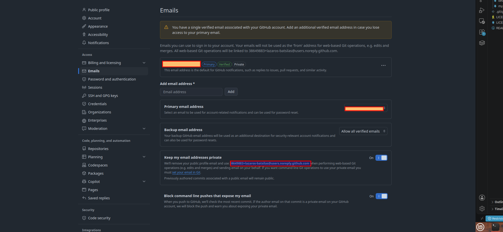

# Setting Up a Professional Python Development Environment on Linux

## Introduction

A reliable development environment is an essential foundation for professional software engineering. Before beginning my journey towards becoming an AI engineer, I assessed my existing hardware, verified my development tools and configured a GitHub repository to document my progress.

My objective is to establish a reproducible, secure and cost-effective development environment.

## Hardware and Operating System

I am using an HP Pavilion laptop running **Linux Mint 22.1 Cinnamon**, based on Ubuntu 24.04 LTS.

| Component | Specification |
|---|---|
| Processor | AMD Ryzen 5 5600H |
| Physical CPU cores | 6 |
| Logical CPU threads | 12 |
| Usable RAM | Approximately 14 GiB |
| Swap space | 2 GiB |
| Main storage partition | 468 GiB |
| Available storage | Approximately 327 GiB |

This configuration should be sufficient for most software engineering, backend development and applied AI exercises in my learning programme. More demanding local AI workloads may require additional computing resources.

### System Verification

The following Linux commands provide useful information about the development environment:

```bash
cat /etc/os-release
lscpu
free -h
df -h
```

## Development Tools

The following software tools are already installed on my system:

| Tool | Purpose | Version |
|---|---|---:|
| Python | Programming | 3.12.3 |
| pip | Python package management | 24.0 |
| Git | Version control | 2.43.0 |
| Docker | Containerisation | 28.1.1 |
| MySQL client | Database access | 8.0.41 |
| Visual Studio Code | Primary code editor | 1.147.0 |
| Vim | Terminal-based text editing | 9.1 |

### Software Verification

The installed versions can be checked using the following commands:

```bash
python3 --version
pip --version
git --version
docker --version
mysql --version
code --version
vim --version
```

!!! note "Environment Verification"
    Checking the installed software versions does not necessarily establish that the corresponding services are running correctly. Docker and MySQL server functionality will be verified in subsequent lessons.

## Git Configuration

Git is the primary version control system for this learning programme.

I verified my existing Git configuration and configured the repository to use a GitHub-generated private email address.

```bash
git config --global init.defaultBranch main
git config --global core.editor "code --wait"
```

The following command allows a repository-specific email address to be configured. 

```bash
git config --local user.email "YOUR_GITHUB_NOREPLY_EMAIL"
```

The no reply email can be found in [GitHub email settings](https://github.com/settings/emails) as shown in the screenschot below: 

Using a repository-specific configuration avoids unintentionally changing the settings of other projects.

## SSH Authentication

SSH provides a secure mechanism for authenticating with GitHub without repeatedly entering account credentials. After [configuring SSH for Github](https://docs.github.com/en/authentication/connecting-to-github-with-ssh), the connection can be tested by:

```bash
ssh -T git@github.com
```

!!! warning "SSH Security"
    Never share your private SSH key or commit it to a Git repository.

## Repository Creation

I adopted a remote-first approach to repository creation:

1. Create a public repository on GitHub.
2. Initialise the repository with a README file and a Python `.gitignore`.
3. Clone the repository using SSH.
4. Verify the local repository configuration.
5. Open the repository in Visual Studio Code.

The repository is called `technical-mastery`.

```bash
mkdir -p ~/Projects
cd ~/Projects
git clone git@github.com:YOUR_USERNAME/technical-mastery.git
cd technical-mastery
```

### Repository Verification

The following commands help verify the current repository state:

```bash
git status
git remote -v
git branch
git log --oneline
```

## Security and Privacy

Security considerations should be incorporated into a project from the beginning.

My initial security practices include:

- Keeping personal email addresses private.
- Using SSH authentication.
- Protecting passwords, private keys and API credentials.
- Reviewing staged changes before committing.
- Avoiding the publication of sensitive information.

> Never commit credentials or other sensitive information to a public repository.

## Lessons Learned

This initial setup demonstrated that my existing hardware and software provide a suitable foundation for the learning programme.

I also discovered that understanding Markdown conceptually is considerably easier than applying its syntax consistently when writing a complete technical document.

My main areas for improvement include:

- Writing structured Markdown documents.
- Using relative file paths correctly.
- Creating tables and fenced code blocks.
- Applying extension-specific syntax, such as admonitions.
- Maintaining a clear and meaningful Git commit history.

These skills will be reinforced through the continuous development of this blog.

## Next Steps

The next stage of the programme will focus on:

1. Creating an isolated Python virtual environment.
2. Installing MkDocs and the Material theme.
3. Configuring the blog structure.
4. Running the website locally.
5. Deploying the website through GitHub Pages.

## References

- [Linux Mint Documentation](https://linuxmint.com/documentation.php)
- [Python Documentation](https://docs.python.org/3/)
- [Git Documentation](https://git-scm.com/doc)
- [GitHub Documentation](https://docs.github.com/)
- [Docker Documentation](https://docs.docker.com/)
- [MySQL Documentation](https://dev.mysql.com/doc/)
- [Visual Studio Code Documentation](https://code.visualstudio.com/docs)