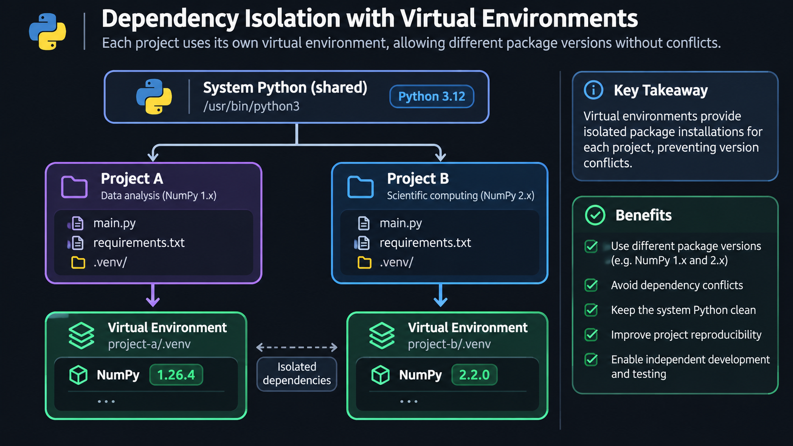
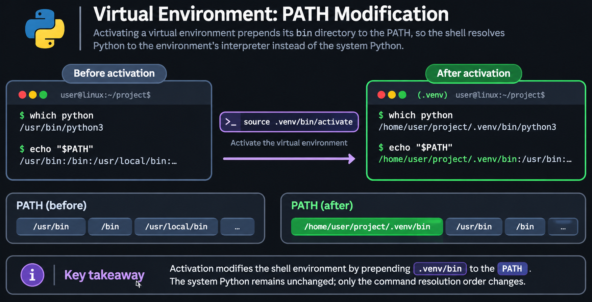
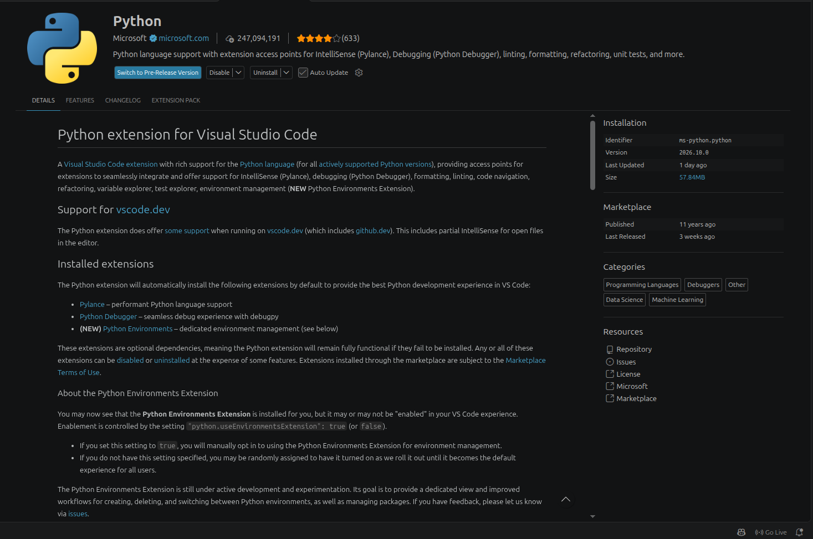

# Python Virtual Environments: From Setup to Understanding

One of the fundamental aspects of establishing a reliable Python development environment is dependency management. As part of my journey towards technical mastery, I explored how Python virtual environments work, how they integrate with Visual Studio Code and Git, and how they contribute to project reproducibility.

## 1. Introduction

### 1.1 The Need for Virtual Environments

Different Python projects may require different packages or different versions of the same package.

For example, consider two projects with incompatible dependency requirements:

- Project A requires NumPy 1.26.
- Project B requires NumPy 2.2.



Installing both versions into the same Python environment would create a conflict.

Python virtual environments address this problem by providing isolated environments in which each project can maintain its own dependencies.

The main advantages are:

- Isolation of project dependencies.
- Prevention of package version conflicts between projects.
- Protection of the system-wide Python environment.
- Improved project reproducibility.
- Easier dependency management and collaboration.

Python provides the built-in `venv` module for creating lightweight virtual environments.

## 2. Under the Hood

### 2.1 Shell Activation and PATH

When a command is executed in a Linux terminal, the shell normally searches the directories specified in the `PATH` environment variable to locate the corresponding executable.

Activating a virtual environment prepends its `bin` directory to `PATH`.

Before activation, the shell may resolve Python to:

```text
/usr/bin/python3
```

After activation, it resolves Python to:

```text
/home/user/project/.venv/bin/python3
```

The system-wide Python installation remains unchanged.

Activation also sets the `VIRTUAL_ENV` environment variable and typically modifies the terminal prompt.

Deactivation restores the previous shell configuration.



### 2.2 Interpreter Selection in VS Code vs Terminal Activation

It is important to distinguish between selecting an interpreter in Visual Studio Code and activating a virtual environment in the terminal.

Interpreter selection determines which Python interpreter is used by the Python extension for operations such as running and debugging Python files.

Terminal activation, on the other hand, modifies the environment of the current shell session.

Visual Studio Code can automatically activate the selected virtual environment when a new integrated terminal is opened, depending on its configuration.

### 2.3 Python Prefixes and Interpreter Initialization

Python exposes several runtime attributes that help identify the interpreter and environment in use. The shell environment variable `VIRTUAL_ENV` provides additional information about activation.

| Attribute | Meaning |
|---|---|
| `sys.executable` | identifies the executable being used |
| `sys.prefix` | identifies the current Python environment's prefix |
| `sys.base_prefix` | identifies the underlying Python installation's prefix |
| `VIRTUAL_ENV` | indicates shell activation, not necessarily which interpreter is running |

These values can be inspected using the [diagnostic script in the reference guide](python-virtual-environments-reference.md#27-comprehensive-python-diagnostic-script). Python recognises a virtual environment during initialization and configures its runtime paths accordingly. 

It is important to note that activating a virtual environment is not strictly necessary to use it. Instead, its Python interpreter can be executed directly:

```bash
.venv/bin/python
```

Therefore there are three ways to invoke Python: 

- Execute `python3` and let the shell resolve the executable through `PATH`.
- Execute the virtual environment interpreter directly: `.venv/bin/python`.
- Execute the system interpreter directly: `/usr/bin/python3`.


The tables in [Appendix A](python-virtual-environments-appendix.md) illustrate the values of the attributes for different activation scenaria and Python invocation commands.

### 2.4 The Virtual Environment Configuration File

Every standard `venv` environment contains a configuration file named `pyvenv.cfg`.

The configuration provides information about the underlying Python installation. Importantly it defines a flag which determines whether system-wide third-party packages should be accessible within the virtual environment.

```text
include-system-site-packages = false
```

By default, the flag is false and system-wide packages are not available within the project.

They do not, however, provide complete operating system isolation. Unlike containers or virtual machines, Python virtual environments primarily address Python interpreter and dependency management.

## 3. Practical How-to Guides

### 3.1 Creating, Activating and Deactivating Virtual Environments

From the root directory of a Python project, a virtual environment can be created using the following command:

```bash
python3 -m venv .venv
```

A common convention is to name the virtual environment `.venv`. The command creates this directory inside the project, containing Python executables or links to them, package installation directories, configuration files and activation scripts.

A simplified directory structure is shown below:

```text
project/
├── .venv/
│   ├── bin/
│   ├── include/
│   ├── lib/
│   └── pyvenv.cfg
└── ...
```

Deactivation does not delete the virtual environment or its installed dependencies. The environment can be activated again whenever required.

The following commands are useful:

| Command | Outcome |
|---|---|
| `python3 -m venv .venv` | Create a virtual environment |
| `source .venv/bin/activate` | Activate the virtual environment |
| `deactivate` | Deactivate the virtual environment |

### 3.2 Installing Packages

| Command | Outcome |
|---|---|
| `python -m pip install package-name` | Install the specified package |
| `python -m pip check` | Check for missing or incompatible declared dependencies |

### 3.3 Virtual Environments and Git

Virtual environments should generally not be committed to a Git repository.

They contain installed dependencies, executable files and potentially platform-specific components that can be recreated locally.

Instead, the virtual environment directory should be excluded by adding the following rule to the project's `.gitignore` file.

The following commands are useful:

| Command | Outcome |
|---|---|
| `git check-ignore -v .venv/` | Identify the applicable exclusion rule |
| `git ls-files -- .venv/` | List tracked files inside the directory |
| `git status --short --ignored` | Display repository status, including ignored files |

An important distinction is that adding a directory to `.gitignore` does not automatically stop Git from tracking files that have already been committed. To stop tracking a previously tracked virtual environment while retaining its local files, remove it from the Git index:

```bash
git rm -r --cached .venv/
```

Review and commit the resulting changes. This command is only necessary if the directory was previously tracked. An empty result from `git ls-files -- .venv/` confirms that no files within it are tracked;  Running `git status --short --ignored` and getting `!! .venv/` is a confirmation that the directory is ignored.

### 3.4 Exporting and Restoring Dependencies

| Command | Outcome |
|---|---|
| `python -m pip freeze > requirements.txt` | Export installed packages in requirements format |
| `python -m pip install -r requirements.txt` | Install dependencies listed in the file |
| `python -m pip check` | Check dependency consistency |

To restore dependencies on another system, first create and activate a new virtual environment, then run the installation command above. The `-r` option tells pip to read requirements from the specified file. Note that `>` in the export command overwrites an existing file.

### 3.5 Dependency Version Constraints

A requirements file may contain different types of version constraints:

| Example | Meaning |
|---|---|
| `package==2.5.0` | Exactly version 2.5.0 |
| `package>=2.5.0` | Version 2.5.0 or newer |
| `package>2.5.0` | Strictly newer than version 2.5.0 |
| `package~=2.5.0` | Compatible releases in the 2.5 series |

Exact version pinning reduces uncertainty when recreating a project's dependencies. However, identical package versions do not guarantee identical behaviour across different Python versions, operating systems, hardware architectures or system libraries.

The `requirements.txt` file should normally be committed to Git.

### 3.6 Configuring Virtual Environments in VS Code

To use the Python-specific development features in VS Code, install the Microsoft Python extension:



Following installation, the interpreter can be selected as follows:

1. Open the project directory in Visual Studio Code.
2. Open the Command Palette using `Ctrl+Shift+P`.
3. Select `Python: Select Interpreter`.
4. Select the interpreter located at `.venv/bin/python`.

The resulting path should correspond to the intended Python environment.

## 4. Troubleshooting and Diagnostics

### 4.1 Identifying the Active Interpreter

When a script fails or a package cannot be imported, first identify which Python interpreter is actually running. The terminal prompt alone is not sufficient.

```bash
which python3
python3 -c "import sys; print(sys.executable, sys.prefix, sys.base_prefix)"
echo "$VIRTUAL_ENV"
```

For a more readable comparison, run [verify_environment.py](#27-comprehensive-python-diagnostic-script) from VS Code and the Terminal.

Different prefixes indicate execution inside a standard `venv` environment. `VIRTUAL_ENV`, by contrast, indicates shell activation. See [Appendix A](python-virtual-environments-appendix.md) for all eight execution scenarios.

### 4.2 Resolving Common Environment Problems

If the VS Code terminal uses the wrong interpreter, check `Python: Select Interpreter`, open a new integrated terminal and verify the interpreter again. If necessary, activate the existing environment manually from the project root:

```bash
source .venv/bin/activate
which python
python -m pip --version
```

If a package is missing, check `python -m pip list` before installing it into the intended environment. Closing a terminal does not delete the environment; use `source .venv/bin/activate` again when needed.

For detailed scenarios, diagnostic steps and solutions, see the [full troubleshooting guide](python-virtual-environments-reference.md#1-troubleshooting-and-diagnostics).

## 5. Essential Commands

The following commands cover the most common tasks on Linux. Run package-management commands using the intended interpreter, normally after activation.

| Command | Purpose |
|---|---|
| `python3 -m venv .venv` | Create a virtual environment |
| `source .venv/bin/activate` | Activate the existing environment |
| `deactivate` | Deactivate the current shell environment |
| `which python3` | Locate Python on PATH |
| `python --version` | Check the Python version |
| `echo "$VIRTUAL_ENV"` | Inspect shell activation |
| `python -m pip --version` | Check pip and its installation location |
| `python -m pip list` | List installed packages |
| `python -m pip install package-name` | Install a package |
| `python -m pip check` | Check declared dependency consistency |
| `python -m pip show numpy` | Show information for package `numpy` |
| `python -m pip freeze > requirements.txt` | Export dependencies, overwriting the file |
| `python -m pip install -r requirements.txt` | Restore dependencies |
| `git check-ignore -v .venv/` | Identify the applicable ignore rule |
| `git ls-files -- .venv/` | Check whether environment files are tracked |
| `git status --short --ignored` | Inspect tracked, untracked and ignored paths |

See the [comprehensive command reference](python-virtual-environments-reference.md#2-comprehensive-command-reference) for additional commands and VS Code actions.

## Conclusion

Python virtual environments are a fundamental component of reliable Python development.

By combining virtual environments with interpreter selection in Visual Studio Code, Git exclusion rules and documented dependencies, developers can establish a more isolated, maintainable and reproducible development workflow.

Understanding the underlying mechanisms, particularly the distinction between shell activation and interpreter initialization, is equally important for diagnosing problems and managing multiple Python projects effectively.

## Further Reading

- [Troubleshooting and Command Reference](python-virtual-environments-reference.md)
- [Appendix A: Interpreter and Prefix Comparison Tables](python-virtual-environments-appendix.md)
